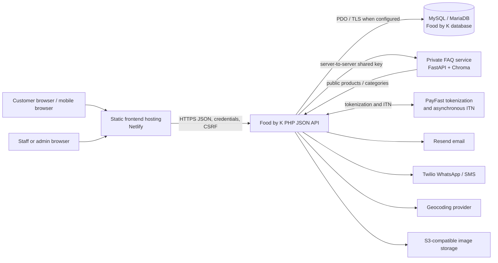
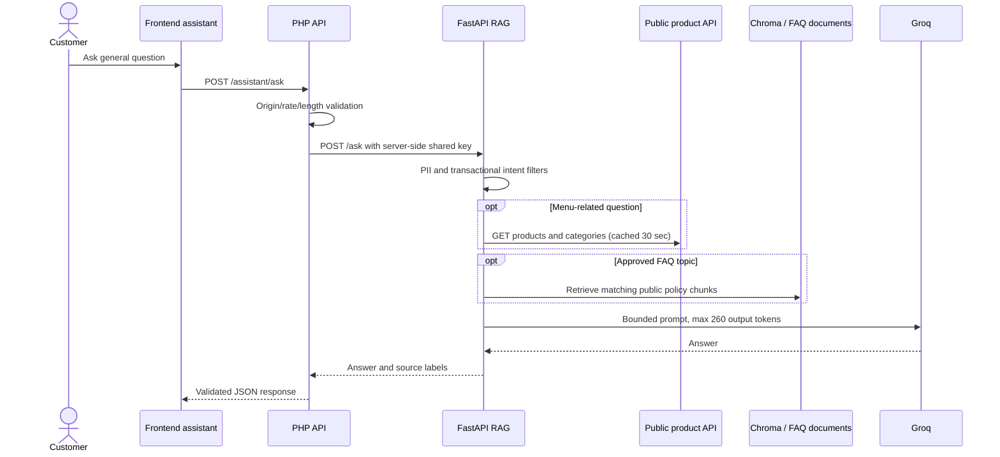

# Food by K — System Architecture (4+1 View)

**Audience:** developers, maintainers, technical reviewers, operators, and project stakeholders  
**Document status:** implementation guide based on the repository as inspected on 13 October 2026  
**Purpose:** explain how the platform is structured, how its major flows work, what quality attributes the implementation supports, and what must be measured or improved before making production guarantees.

> This document distinguishes repository facts from proposed service targets. It is not a claim that production has met a particular latency, availability, compliance, or security certification. Deployment dashboards, production configuration, and measured telemetry remain authoritative for runtime facts.

## 1. System purpose and scope

Food by K is a mobile-first pre-ordering platform for a fast-food business. Customers browse a public catalogue, sign in, prepare a cart, select delivery or collection, choose a preferred time window, and submit an order. Staff review each submission. Payment is tokenized at submission and charged only after staff accept or adjust the order. Customers see order progress in the browser and receive configured transactional notifications.

The platform is split into separately deployable parts:

- **Customer web frontend:** static HTML, CSS, and JavaScript under `frontend/`; intended for Netlify hosting. It calls the PHP API and does not execute PHP.
- **Business API:** plain PHP application under `backend/foodbyk/`, exposed through `backend/public/`; expected to run as a PHP web service (Railway in the current deployment setup).
- **Relational persistence:** MySQL 8 or compatible MariaDB through PDO, holding accounts, catalogue, carts, addresses, orders, payments, and audit history.
- **FAQ assistant:** a separate FastAPI service under `RagService/`; the PHP API is its only platform-facing proxy. It serves menu and approved public policy FAQ questions, not account or order actions.
- **External providers:** PayFast, Resend, Twilio, a geocoding service, and S3-compatible object storage, when configured.

The authoritative business decisions are in [`DOMAIN.md`](DOMAIN.md). Environment and architecture conventions are in [`AGENTS.md`](AGENTS.md). The tests and their limits are described in [`backend/tests/README.md`](backend/tests/README.md) and [`backend/tests/USER_ACCEPTANCE.md`](backend/tests/USER_ACCEPTANCE.md). POPIA-related code findings and operational work are in [`backend/foodbyk/POPIA_REVIEW.md`](backend/foodbyk/POPIA_REVIEW.md).

## 2. Architecture at a glance



The RAG service’s menu lookups call the public catalogue endpoints on the PHP API. This is a one-way data dependency: the PHP API calls the RAG service for customer FAQ answers, while RAG calls only the public product/category API for live menu facts. RAG does not connect directly to the business database.

## 3. View 1 — Logical view

The logical view describes the main responsibilities, domain objects, and rules independently of deployment location.

### 3.1 Actors and capabilities

| Actor | Main capabilities | Trust boundary |
|---|---|---|
| Anonymous visitor | Browse public categories, products, promotions, and general FAQ answers | No account identity; public data only |
| Customer | Register/login, manage profile and delivery addresses, manage cart, submit/cancel eligible orders, follow the newest order, review policy versions, request account deletion | Authenticated customer session; customer ownership enforced server-side |
| Staff | Review incoming orders, confirm/adjust/decline, advance preparation status, manage product availability | Authenticated staff role; status changes are guarded and recorded |
| Admin | Manage staff, customers, catalogue, promotions, and business settings | Authenticated admin role; sensitive management operations are server-authorized |
| External provider | Payment, messaging, email, geocoding, storage, or model generation | Separate credentials, network failures, provider-specific data processing |

The `users` table is a single-table identity model differentiated by `roles.role_name` (`customer`, `staff`, `admin`). Role is determined by the server, never accepted as a trusted registration field. There are no `Customer`, `Staff`, or `Admin` tables; the PHP models specialize access/behavior over the shared user record.

### 3.2 Application layers and ownership

The backend uses **Controller → Service → Model → Database**:

1. **Router and middleware** match HTTP method/path, establish the request user, check role, CSRF, rate limits, and current policy acknowledgment where required.
2. **Controller** parses request values, invokes one application-service method, and maps the service result to an HTTP response. It should not own business rules or open PDO transactions.
3. **Service** owns input/business validation, multi-model coordination, provider calls, transaction boundaries, and expected failure results.
4. **Active Record model** maps one business record/table and performs persistence plus small local invariants. Models must not coordinate services or own transaction boundaries.
5. **Database** is MySQL/MariaDB accessed by prepared PDO statements, schema constraints, foreign keys, and indexes.

Services return the shared result shape `success`, `data`, and `error`; controllers convert this into JSON. This convention makes expected domain failures distinct from unexpected infrastructure exceptions.

### 3.3 Domain concepts and persistence

The current schema in `backend/foodbyk/database/migration.sql` is the data dictionary. Main records are:

| Concept | Main tables | Key relationships and rules |
|---|---|---|
| Identity and authorization | `users`, `roles`, `password_resets`, `login_attempts`, `policy_acceptances` | Email is unique; user role references `roles`; reset tokens are stored as hashes; policy acknowledgments are versioned by user/type/version. |
| Catalogue | `categories`, `products`, `promotions` | Products belong to categories; products can be hidden/removed without breaking historical order-item references; promotion values have bounded calculations. |
| Customer preparation | `cart_items`, `addresses` | Cart rows belong to a customer and product; addresses store structured fields plus raw address and optional geocoded coordinates. |
| Order aggregate | `orders`, `order_items`, `order_status_history` | Orders belong to a customer and snapshot line-item name/price; delivery orders require an address; every status change should create an audit-history row in the same transaction. |
| Payment | `payments` | One payment row per order; token is a charge-capable secret; token storage is encrypted by the `Payment` model using AES-256-GCM when configured. |
| Business configuration | `business_settings` | Singleton settings row controls trading hours, delivery/collection radii, fees, service flags, and slot limits. |

`orders` combines collection and delivery rather than using a subtype table. The database check constraint enforces delivery-address consistency. `order_items` preserve submitted product labels/prices so later catalogue edits do not rewrite historical orders. Product and account soft-deactivation preserve historical references.

### 3.4 Important business state machines

Order state transitions are centralized in `Order::ALLOWED_TRANSITIONS` and guarded by `Order::canTransitionTo()`. The normal path is:

```text
submitted → accepted or adjusted → charge_pending → paid → preparing → ready → completed
submitted → declined
eligible pre-charge states → cancelled
charge_pending → payment_failed → charge_pending (retry) or cancelled
```

The exact transition map in `backend/foodbyk/models/Order.php` is authoritative. A status mutation must run in a service transaction after `Order::lockById()` (`SELECT … FOR UPDATE`) and write `order_status_history` before commit. A paid order has no in-app cancellation/refund transition in the current scope; manual staff handling is required.

Payment follows a separate state progression on the single `payments` row: tokenized, charge pending, then success/failed/voided. The tokenization callback does not mean funds were charged. Staff acceptance triggers the charge request; a later PayFast ITN confirms the result. Webhooks can be retried, so state handlers must remain idempotent.

Delivery uses structured customer input, an address geocoder, and Haversine distance against the configured radius. The platform checks delivery/collection availability and fee before order submission. This is a straight-line estimate, not route distance or a guarantee of physical access.

### 3.5 Bounded FAQ assistant domain

The assistant is deliberately not part of the transaction domain. It can answer public menu facts and approved general FAQs. It must not decide order status, price paid, payment outcome, refunds, delivery eligibility, collection availability, or account-specific matters.

The PHP `RagAssistantService` accepts at most 500 characters, requires its service URL/key, and proxies to FastAPI with a 30-second timeout. The FastAPI service requires `X-RAG-Service-Key`, rejects PII-like prompts, handles transactional questions with deterministic handoff text, and uses live product/category data plus a small Chroma FAQ retrieval set. The product service has a 30-second in-memory cache, uses at most four product records as model context, and queries the catalogue endpoints with 3-second connect / 5-second read timeouts. Groq generation uses an 18-second timeout, no automatic retries, low temperature, and a 260-token output ceiling. These are implementation limits, not an answer-quality or latency guarantee.

## 4. View 2 — Development view

The development view describes the repository boundaries, dependency rules, and change workflow.

### 4.1 Repository map

```text
frontend/
  src/index.html                 home page
  pages/auth/                    login, registration, account, password flows
  pages/customer/                menu, cart, checkout, orders, payment return UX
  pages/legal/                   terms, privacy, cookie notice
  public assets/css/             shared and page styles
  public assets/js/              page logic, API client, auth, navigation, assistant
backend/public/                  PHP HTTP entry point and local router
backend/foodbyk/
  bootstrap.php                  config load, session, autoloading, PHP settings
  config/                        environment-backed constants and templates
  core/                           Request, Response, Router
  middleware/                     auth, role, CSRF, rate limits, policy gate
  controllers/                    thin HTTP boundary
  services/                       workflows and provider integration
  models/                         Active Record and local state rules
  database/                       schema, upgrades, PDO connection
RagService/                       FastAPI FAQ retrieval and generation service
backend/tests/                    PHP checks, API/database checks, documentation
frontend/tests/                   Playwright browser tests
.github/workflows/ci.yml          CI checks
```

The backend is plain PHP (no application framework or ORM). A custom autoloader searches `core`, `middleware`, `models`, `services`, and `controllers`; `Model` and `Database` have explicit special cases. The frontend and backend are independently deployable artifacts connected by a JSON API.

### 4.2 Dependency rules

- Controllers must not issue SQL or coordinate multiple services for one request.
- Services own transactions and cross-model workflows. Avoid adding repositories/factories/ORM layers without a demonstrated concrete need; current Active Record is intentional.
- Models may enforce small domain invariants but do not start transactions.
- Order status logic must not be duplicated outside the order state machine.
- Delivery fee variations belong behind `DeliveryFeeStrategy` implementations.
- Notification channels belong behind the `OrderNotifier` observer interface.
- Provider credentials remain in environment/deployment secrets, not frontend assets or source control.
- Do not add business logic to static HTML pages. Frontend validation improves usability; backend validation remains authoritative.

### 4.3 Frontend organization

Static page files load shared configuration and API helpers, then page-specific JavaScript. `api.js` centralizes HTTP requests, credentials, CSRF bootstrap, status normalization, and the session-header fallback. `auth.js`, `navigation.js`, `account.js`, `orders.js`, checkout/cart/menu scripts, and `assistant.js` own page-level interactions.

The browser must not receive database credentials, PayFast secrets, the payment encryption key, RAG shared key, Twilio/Resend secrets, or model provider keys. Keep server secrets on the PHP or RAG deployment only. Persistent browser data should be minimized; the session token is held in `sessionStorage`, while the local user snapshot is only an ID/role display hint and must never authorize a backend request.

### 4.4 Build and CI workflow

`.github/workflows/ci.yml` runs on pushes and pull requests to `main`. It currently contains three jobs:

1. **Backend unit/security:** PHP 8.3 lint, model/domain/data-validation checks, and payment-token security checks.
2. **Database/API integration:** disposable MySQL 8 database, schema creation, constraint/transaction checks, local PHP API, and session/CSRF/role/CORS integration checks.
3. **Customer UI:** Node 22, Playwright dependency install, Chromium browser tests, and trace upload on failure.

The CI database is named `foodbyk_test`; integration checks must never target a developer or production database. Real PayFast, Resend, Twilio, device/browser diversity, accessibility review, and production data deletion/restore checks need staging or manual UAT.

### 4.5 Safe database change workflow

- For a new database, use `database/migration.sql`.
- For an existing database, inspect its current schema and data, back it up, and apply only the incremental upgrade scripts that are still missing. The repository includes hardening, address-province, and POPIA upgrades; these are not interchangeable with a fresh schema.
- Apply schema before deploying code that requires the new columns/tables. In particular, `PolicyService` depends on `policy_acceptances`, and deletion uses `users.deleted_at`.
- Never rerun a non-idempotent migration blindly. Verify with `SHOW COLUMNS` / `SHOW TABLES` first, especially after a partially successful migration.
- Run schema and transaction changes against a disposable database in CI or staging; production migration timing and rollback plan are operational decisions.

## 5. View 3 — Process view

The process view covers runtime behavior, request lifetimes, concurrency, and failure modes.

### 5.1 Customer browse, cart, and order submission

```mermaid
sequenceDiagram
    actor C as Customer browser
    participant F as Static frontend
    participant A as PHP API
    participant M as Middleware
    participant S as Services/models
    participant D as MySQL
    participant P as PayFast
    C->>F: Browse menu
    F->>A: GET products/categories
    A->>D: Query public active catalogue
    D-->>F: JSON catalogue
    C->>F: Add item / checkout
    F->>A: Authenticated API request
    A->>M: Session, role, CSRF, current policy
    M-->>F: 401/403/419/428 or continue
    F->>A: Preview / submit order
    A->>S: Validate cart, address, slot, price, promotion
    S->>D: Transaction; lock customer and persist order snapshots
    S->>P: Tokenization redirect/request initiation
    P-->>A: Tokenization ITN
    A->>D: Persist encrypted token / payment state
```

The frontend submits intent and displays API responses; it does not determine final order acceptance or payment state. Server-side prices, promotion rules, trading hours, address ownership, radius, and order transitions are authoritative.

### 5.2 Staff review and asynchronous payment

```mermaid
sequenceDiagram
    actor Staff
    participant UI as Staff browser
    participant API as PHP API
    participant DB as MySQL
    participant PF as PayFast
    participant N as Notification providers
    Staff->>UI: Open incoming order
    UI->>API: GET staff order list/detail
    API->>DB: Read role-scoped orders
    Staff->>UI: Confirm, adjust, or decline
    UI->>API: POST staff action + CSRF
    API->>DB: Begin; SELECT order FOR UPDATE
    API->>DB: Validate transition; write status and history
    alt confirmed or adjusted
        API->>PF: Charge stored token
        PF-->>API: Later charge ITN
        API->>DB: Idempotently record payment and order state
    else declined
        API->>DB: Void unused token; preserve no-charge outcome
    end
    API->>N: Notify customer/staff through configured observers
```

PayFast notification delivery is asynchronous. The customer page polls the newest order every 10 seconds while open; it does not use a server push/WebSocket connection. The UI’s “optimistic” feel is therefore quick refresh and status presentation, not local prediction of staff actions.

### 5.3 Authentication and customer policy review

Sessions are server-side PHP sessions with an idle timeout of 2 hours and absolute lifetime of 24 hours. Login/register regenerate the session ID. The frontend sends credentials and a CSRF token for state-changing calls. For browsers where cross-site cookies are blocked, the API can resume a session from an `X-Session-Token` fallback held in session storage.

Customer order/address endpoints require accepted current terms and privacy-notice versions. The account profile, policy acceptance endpoint, and deletion endpoint remain available so a legacy customer can review documents or delete the account. The cookie preference is a separate browser choice; it is not used as proof of terms/privacy acceptance.

### 5.4 FAQ request lifecycle



The assistant makes no direct account or order database query. If the upstream RAG service or model is unavailable, the backend returns a temporary-unavailable error; transactional questions are directed to staff rather than guessed.

### 5.5 Account deletion transaction

Deletion is an authenticated customer action requiring password re-entry. The service locks the user row, checks for unresolved order/payment states, removes carts and reset links, deletes addresses not referenced by retained orders, redacts address data on historical address rows, clears payment tokens, pseudonymizes the user row, scrubs free-text order notes, removes the email-keyed rate-limit row, commits, and destroys the active session. Order submission locks the same customer row, serializing account deletion against concurrent new orders.

Historical order/payment rows remain linked to a pseudonymized user record so foreign keys and reconciliation records remain usable. This is not a universal hard-delete guarantee. The business must establish lawful retention periods and backup expiry; see the POPIA review.

## 6. View 4 — Physical view

The physical view describes deployment units and network communication. Actual service names, regions, capacity, and database topology must be checked in Netlify/Railway/provider dashboards because source code cannot prove runtime configuration.

| Node / deployment unit | Contents | Network exposure | Important configuration |
|---|---|---|---|
| Netlify site | Static customer HTML/CSS/JS | Public HTTPS | API base URL, correct asset paths, allowed frontend origin; no server secrets |
| PHP API service | PHP 8.3-compatible web runtime, router, application layers | HTTPS JSON API | `APP_ENV`, DB credentials/TLS CA, frontend origin, payment, email, Twilio, RAG secrets, encryption key |
| MySQL/MariaDB | Relational schema and transactions | Private service network where available; do not expose publicly without need | Dedicated least-privilege account, backups, TLS, migrations, connection limits |
| FAQ service | Python/FastAPI, retriever, product adapter, Chroma index | Private/server-to-server Railway route preferred; `/health` public for health checks | `RAG_SERVICE_API_KEY`, `GROQ_API_KEY`, `FOODBYK_API_URL`, persistent `/data` volume |
| Object storage | Menu images | Public/signed read URLs as configured; privileged writes server-side | S3-compatible endpoint, bucket, region, key permissions |
| External SaaS | PayFast, Resend, Twilio, geocoder, Groq | Outbound HTTPS and provider webhooks | Per-environment keys, callback URLs, templates, sandbox/live separation |

Production secrets should be held in each service’s deployment secret manager and rotated independently. Sandbox and live payment sender configuration must not be mixed. The RAG API key is server-to-server only; it must never be embedded in Netlify assets.

### Network and availability boundaries

- Browser-to-API requests cross origins. CORS must allow only expected frontend origins; credentials require an explicit origin, not wildcard access.
- PHP-to-MySQL uses PDO; `DB_SSL_CA` enables configured TLS verification. Production startup requires explicit DB credentials and a payment-token encryption key.
- PHP-to-RAG is synchronous, sends a bounded JSON question and shared-key header, and has a 30-second timeout.
- Provider notifications and payment callbacks depend on outbound/inbound network reachability and provider retry behavior.
- The RAG Chroma data directory must use persistent storage if index state is expected to survive a Railway restart. Rebuild the collection before switching the index pointer.
- There is no queue, event bus, or dedicated worker in the current architecture. Notification calls and several provider interactions are synchronous from PHP; provider latency can affect request/transaction duration.

## 7. +1 View — Scenarios

The +1 view ties the other four views together through representative use cases.

### Scenario A: first-time customer creates an account and orders

1. The browser downloads static pages from Netlify and fetches public products/categories from PHP.
2. Registration sends a name/email/password and requires explicit terms acceptance plus privacy-notice acknowledgment. PHP normalizes and validates inputs, creates a customer role-bound user in a transaction, writes two policy-version rows, and establishes a regenerated server session.
3. The customer adds items. API middleware authenticates the session, checks customer role, validates CSRF for writes, and gates protected functions on current policy versions.
4. Checkout obtains current cart/product values, validates address/service radius and slot, calculates fee/promotion, and creates order/item/payment records transactionally.
5. PayFast tokenization is completed externally; the webhook stores the protected token. No charge occurs until staff accepts or adjusts.

**Architecture concerns:** user-visible price is not trusted by backend; token is secret; failures must not leave partial order/payment records; external callbacks can repeat.

### Scenario B: staff accepts, payment webhook arrives twice

1. Staff opens an authorized order list and confirms or adjusts one order.
2. Service begins a DB transaction, locks the order row, verifies allowed transition, persists state/history, and requests a token charge.
3. PayFast later posts a charge ITN. The API validates provider data and coordinates payment/order/history changes transactionally.
4. A duplicate ITN must be an idempotent no-op for already-successful payments. Notification failures are logged and should not reverse a committed order state.
5. Customer page polls every 10 seconds while open and displays the latest server state.

**Architecture concerns:** race control is DB row locking, payment is asynchronous, and polling provides freshness without push infrastructure.

### Scenario C: legacy customer accepts updated policies

1. Login verifies credentials and includes `policy_acceptance_required` based on the active policy versions.
2. Frontend routes the customer to the account policy card. Navigation does not request protected order data while policy review is pending.
3. The customer opens the versioned documents and submits the separate checkboxes.
4. PHP records acceptance time and version. Future customer business requests pass the policy middleware.

**Architecture concerns:** the `policy_acceptances` table must be migrated before deployment. If it is missing/unavailable, login can still complete and the customer remains blocked from protected functions until acknowledgment is persisted; application logs should identify the database fault for operators.

### Scenario D: customer requests account deletion

1. Customer re-enters password and confirms the irreversible action.
2. Account service locks the user, rejects deletion if order status indicates unresolved fulfillment/payment, and performs erasure/pseudonymization in a single DB transaction.
3. Existing historical order links remain valid, delivery address details are cleared, and PayFast tokens are removed.
4. The service destroys the session. The browser clears its cached user hint/session token and returns to the public site.

**Architecture concerns:** statutory/accounting retention and provider/backups are not fully controlled by this endpoint; the retention schedule and deletion propagation need operational ownership.

### Scenario E: customer asks “what can you answer?”

1. Frontend sends the question only to the PHP API.
2. PHP applies request origin, size, and rate controls and sends its RAG shared key only server-side.
3. FastAPI matches capability and transactional patterns before model invocation. Capability requests receive a deterministic list of supported topics; account/order/payment/delivery questions receive a handoff.
4. Menu queries use the live public API and short process-local cache; general policy FAQ queries retrieve only approved document chunks.
5. The answer is bounded and returned with source labels where available.

**Architecture concerns:** RAG is not a source of transactional truth; retrieved documents need review and version control; service/provider failures must remain explicit.

## 8. Quality attributes and measurable indicators

### 8.1 Current mechanisms and limits

| Attribute | Implemented mechanisms | Known limit / evidence still needed |
|---|---|---|
| Security | Password hashing (Argon2id with bcrypt fallback), session regeneration/expiry, auth/role middleware, CSRF token checks, prepared statements, login/reset/assistant rate limits, encrypted payment tokens, server-side secrets, webhook/idempotency guards, RAG shared key and PII/transactional filters | A code review is not a penetration test. Confirm TLS/CORS/secrets/log masking and production error display settings. No WAF, centralized SIEM, formal threat model, or external pentest is established by this repo. |
| Privacy / compliance | Data minimization in browser cache, account correction controls, policy version audit, account erasure with order pseudonymization, cookie choice, privacy notice and terms drafts | Legal-party/Information Officer details, retention periods, operator contracts, cross-border map, breach procedure, PAIA handling, deletion propagation, and counsel review are operational prerequisites; see `POPIA_REVIEW.md`. |
| Performance | Indexed FK/status/category/time queries; database-side filtering; bounded RAG context/output; 30-second product cache; small static frontend; 10-second order polling | No production load-test report or latency histogram is checked in. Synchronous PHP/provider I/O and polling can become bottlenecks; query plans and p95/p99 need measurement. |
| Reliability | Database transactions, order row locks, state machine, webhook idempotency, provider timeouts in several integrations, health endpoints, restart policies for RAG | No outbox/queue, multi-region failover, defined RTO/RPO, or measured uptime objective appears in the repository. Some notification channels can fail after business state commits. |
| Scalability | Static frontend scales separately; PHP API can be replicated if session/database configuration supports it; MySQL indexes; RAG is independent from core API | PHP sessions may require sticky sessions or shared session storage across replicas. The DB is the central write bottleneck. In-memory RAG catalogue cache is per process and Chroma access needs durable volume/coordination. |
| Maintainability | Clear layer boundaries, authoritative domain guide, narrow strategy/observer/state-machine patterns, migration scripts, CI separation, API result convention | Plain PHP has no framework-level contracts; keep controller/service boundaries disciplined. Ensure docs and schema upgrades move with features. Frontend remains multi-page scripts rather than component framework. |
| Usability/accessibility | Mobile-first pages, loading/skeleton states, account/policy flows, 10-second current-order refresh, error messages | Automated Playwright Chromium tests do not replace iOS/Android device, screen-reader, keyboard, contrast, or network-loss testing. |
| Cost efficiency | Static web hosting; FAQ fallback before generation, short live-catalogue cache, four-product context cap, 260-token generation limit | Track model tokens/cost, provider messages, database/storage growth, and geocoding usage; no cost dashboard or budget alert is defined here. |

### 8.2 Performance and capacity targets (proposed, not measured)

The repository does not contain production traffic profiles or a benchmark baseline. The following are **initial service objectives to validate**, not achieved metrics:

| Measure | Initial target | Measurement method |
|---|---:|---|
| Public catalogue API p95 | ≤ 500 ms under expected daytime traffic, excluding image delivery | API gateway/application timing histogram by route and status |
| Authenticated API p95 (non-provider routes) | ≤ 700 ms | Trace middleware/controller/service/DB timings; separate cold starts |
| Database query p95 | ≤ 100 ms for indexed request-path queries | MySQL slow query log + performance schema; inspect `EXPLAIN ANALYZE` |
| Order submit p95 | ≤ 2 s excluding customer-controlled PayFast navigation/provider latency | End-to-end trace split into validation, SQL transaction, provider calls |
| RAG answer p95 | ≤ 8 s when upstream providers are healthy | Track PHP proxy, product fetch, retrieval, and model time separately |
| HTTP error rate | < 1% over a rolling 30-minute business window, excluding expected 4xx | Status-code metrics and alerting |
| Availability | Set only after hosting/dependency monitoring is in place | External uptime checks plus database/provider health |

Do not treat these values as contractual until representative load tests and production baselines are collected. Establish request volume, concurrency, menu size, orders per peak slot, and expected notification/assistant volume before capacity sizing.

### 8.3 Scaling path

Scale in this order, guided by measurement:

1. Add route-level timing, correlation IDs, DB slow-query visibility, and provider error/latency metrics without logging secrets or customer payloads.
2. Fix query plans, N+1 reads, and missing indexes before increasing server size. Preserve existing indexes and validate schema constraints.
3. Keep the frontend static and cache only public catalogue assets/data with short, explicit invalidation rules.
4. If PHP replicas are added, move session state to shared storage or another validated stateless session design. Local filesystem sessions are not a safe multi-replica assumption.
5. Move email/SMS and other non-critical side effects to an outbox/queue if synchronous provider calls affect request latency or reliability. Keep payment state/webhook processing transactionally idempotent.
6. Scale MySQL with tested connection pooling/limits and backup/restore practice. Read replicas are only appropriate for stale-tolerant reads; order/payment state and authorization decisions need primary consistency.
7. Scale RAG separately. Preserve the Chroma volume, coordinate index rebuilds, enforce service authentication/rate limits, and cap model input/output/cost. Keep live catalogue facts authoritative.

## 9. Security and operational design rules

### 9.1 Security boundaries

- Public read endpoints should return only public active catalogue data.
- Authentication proves identity; role middleware proves actor class; each service must still verify record ownership and untrusted values.
- State-changing browser requests require CSRF checks. CORS is not authentication.
- Do not trust customer ID, role, item price, delivery fee, payment status, or order status supplied by the browser.
- PayFast gateway tokens are secrets capable of initiating a charge. Never log or return them; retain encryption key backups securely and separate sandbox/live credentials.
- Webhooks must verify their provider signature/identity and remain idempotent under retries.
- RAG keys and model credentials are backend-only. Keep the RAG endpoint unavailable to direct unauthenticated customer calls; expose health only as needed for service checks.
- Avoid sensitive values in application logs. Use order IDs/correlation IDs and sanitized provider error codes rather than tokens, full addresses, passwords, or full payment payloads.

### 9.2 Privacy and data handling

Customer data is distributed between the PHP database and configured processors. The privacy notice must reflect the actual providers and transfers in deployment. Account deletion does not purge retained financial/order records, provider logs, or backups automatically; these need a documented schedule and processor process. Policy version changes require synchronized updates to the legal document and `PolicyService` constants.

### 9.3 Reliability/operations

Operators should monitor API health, database availability/connection saturation, payment callback failures, notification delivery failures, RAG 503/token usage, and storage capacity. A public health response is a liveness indicator, not proof that every dependency is usable. Define who receives alerts and how staff manually resolve orders when PayFast or notification providers are unavailable.

Document backups, retention, restore drills, secret rotation, incident escalation, and rollback steps. Neither repository nor CI establishes production RPO/RTO; choose them with the business and test restore capability before publishing objectives.

## 10. Developer change checklist

Before merging a change, identify which logical domain and runtime scenario it affects. Then:

1. Update `DOMAIN.md` if a business rule changes; update this guide if a structural decision changes.
2. Place validation/workflow in the service, persistence in the model, and HTTP translation in a thin controller.
3. Use transactions and row locks for order/payment state mutations; preserve order history and webhook idempotency.
4. Add/adjust schema migrations for every persistent data change. Make migration instructions explicit for both fresh and existing databases.
5. Review auth, role, ownership, CSRF, rate-limit, data minimization, log exposure, and provider failure behavior.
6. Keep browser/API contracts aligned. Never put server secrets into the static frontend.
7. Run the relevant CI checks and manual user-acceptance scenarios; do not claim performance targets without measurement.
8. Note external configuration or manual provider steps in release notes, including callback URLs and sandbox/live differences.

## 11. Glossary

| Term | Meaning in this platform |
|---|---|
| ITN | PayFast Instant Transaction Notification webhook used to confirm asynchronous tokenization/charge events |
| Tokenization | PayFast stores the card details and returns a token; the application stores only the protected token, not the full card number |
| Active Record | Model object encapsulates persistence for its database record/table |
| Policy acknowledgment | Versioned record that customer accepted the terms and acknowledged reading the privacy notice; distinct from cookie preference and marketing consent |
| RAG | Retrieval-augmented generation; FAQ documents and live public menu data are retrieved to ground a bounded answer |
| 4+1 | Logical, development, process, and physical views, plus scenarios that validate the architecture across those views |
